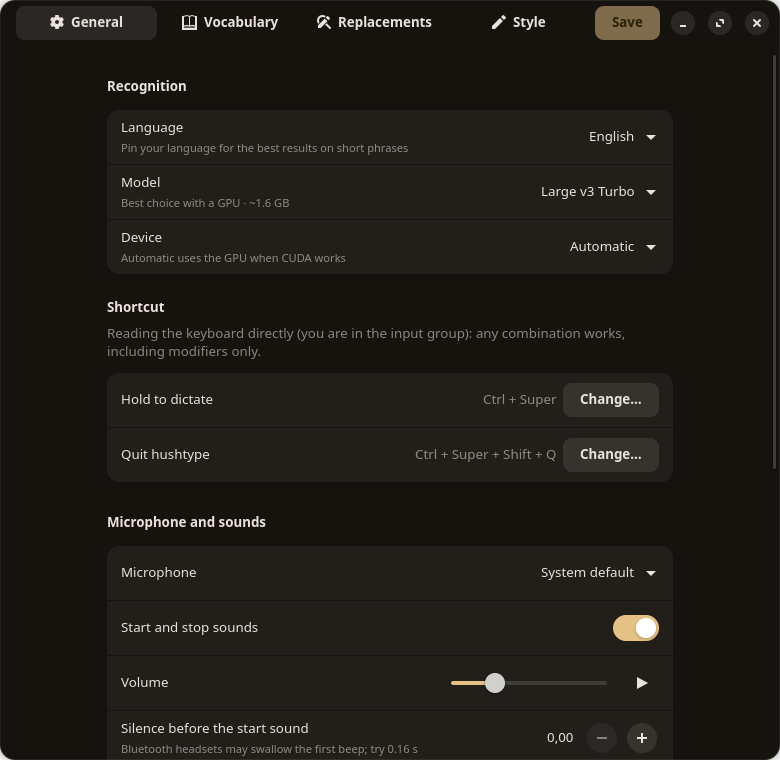
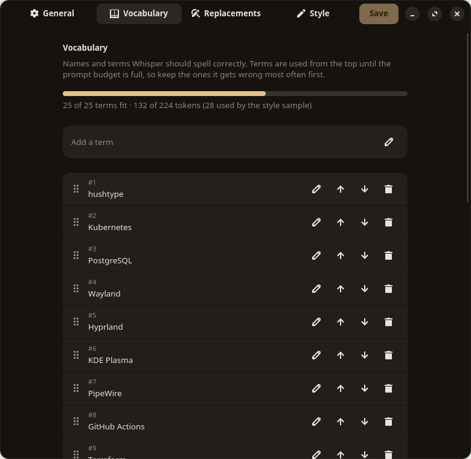

<div align="center">


# hushtype

**Private, offline hold-to-talk dictation for Linux.**

Hold a key, speak, let go. Your words are typed into whatever window has focus.

[](https://github.com/kartalc23/hushtype/actions/workflows/ci.yml)
[](https://github.com/kartalc23/hushtype/releases)
[](LICENSE)


</div>

Speech is transcribed on your own machine with [Whisper](https://github.com/openai/whisper)
(via [faster-whisper](https://github.com/SYSTRAN/faster-whisper)). No account, no subscription, no
word limits, and nothing you say ever leaves your computer.

Built for Wayland first and works on X11 too. Developed and tested on KDE Plasma 6 (Wayland);
reports from other desktops are very welcome.

## Features

- **Hold-to-talk on any key combo**, including modifier-only ones like `Ctrl+Super`
- **Pastes into any app**: terminals, browsers, editors, chat apps
- **Fast on a GPU**: about 14 to 24x realtime with `large-v3-turbo` on an RTX 3060, so a sentence
  appears well under a second after you let go. Runs on CPU too, just slower
- **Your words, spelled right**: a vocabulary list for names and jargon, a style sample for how
  you talk, and `wrong => right` replacement rules
- **100 languages**, auto-detected or pinned
- **A real settings window**: language, model, shortcut recorder, microphone, vocabulary with a
  live prompt-budget meter, replacement rules with a tester; changes apply without a restart
- **Unobtrusive**: a small animated pill at the bottom of the screen while you talk, a tray icon,
  soft start/stop beeps
- **Leaves no trace**: dictated text is never written to disk or to the log, and the network is
  used exactly once, to download the model

## Contents

[Install](#install) · [Use](#use) · [Configure](#configure) · [How it works](#how-it-works) ·
[Troubleshooting](#troubleshooting) · [Roadmap](#roadmap) · [Contributing](#contributing)

## Install

Requires Python 3.11+ and a working microphone. An NVIDIA GPU is optional but recommended.

```bash
git clone https://github.com/kartalc23/hushtype.git
cd hushtype
./install.sh              # add --autostart to start on login, --cpu to skip CUDA
```

The installer adds the required distro packages (Arch, Debian/Ubuntu and Fedora are
recognised), creates an isolated environment in `~/.local/share/hushtype`, links the
`hushtype` command into `~/.local/bin` and adds an app menu entry. Run `hushtype doctor` any time
to see what works and what is missing.

The first start downloads the model (about 1.6 GB for `large-v3-turbo`) to `~/.cache/hushtype`.

### Arch Linux (native package)

A PKGBUILD lives in `packaging/aur`. `paru` (or `yay`) pulls the dependencies from the AUR:

```bash
git clone https://github.com/kartalc23/hushtype.git
paru -Bi hushtype/packaging/aur  # or: yay -Bi hushtype/packaging/aur
paru -S python-ctranslate2-cuda  # optional: NVIDIA GPU acceleration
hushtype init
```

Then start hushtype from the app menu. CTranslate2 is built from source, so the first install
takes a while. For hold-to-talk on any key combo, add yourself to the `input` group
(`sudo usermod -aG input $USER`) and reboot.

<details>
<summary>Manual install (pipx, other distros)</summary>

Install these from your distro: GTK 4, libadwaita, gtk4-layer-shell, PyGObject, libayatana-appindicator,
PortAudio, wl-clipboard (Wayland) or xclip (X11), plus the cairo headers and pkg-config for
building pycairo. Then:

```bash
pipx install --system-site-packages "hushtype[cuda] @ git+https://github.com/kartalc23/hushtype"
hushtype init
hushtype install-desktop
```

`--system-site-packages` lets hushtype use your distro's GTK bindings. Leave out `[cuda]` on
machines without an NVIDIA GPU.
</details>

## Use

Start **hushtype** from your app menu (or run `hushtype` in a terminal to watch its log).

| | |
|---|---|
| Dictate | Hold **Ctrl + Super**, speak, release |
| Quit | **Ctrl + Super + Shift + Q**, or tray icon → Quit |
| Settings | Tray icon → Settings…, the app menu, or `hushtype settings` |
| Toggle from a script | `hushtype toggle` (start/stop recording in the running instance) |

<details>
<summary>All commands</summary>

| Command | What it does |
|---|---|
| `hushtype` | Start dictation (same as `hushtype run`) |
| `hushtype settings` | Open the settings window |
| `hushtype toggle` | Start or stop a recording in the running instance |
| `hushtype reload` | Re-read config and text files in the running instance |
| `hushtype transcribe FILE` | Transcribe an audio file and print the text and speed |
| `hushtype mics` | List microphones |
| `hushtype doctor` | Check permissions and dependencies |
| `hushtype init [--force]` | Write a commented config and example text files |
| `hushtype install-desktop [--autostart]` | Add the app menu entry (and start on login) |
| `hushtype uninstall-desktop` | Remove the app menu and autostart entries |
</details>

### Two ways to catch the hotkey

**Desktop portal (default, no setup).** Without extra permissions hushtype registers its shortcut
through the [GlobalShortcuts portal](https://flatpak.github.io/xdg-desktop-portal/docs/doc-org.freedesktop.portal.GlobalShortcuts.html).
The desktop asks you to confirm it once. Portals refuse modifier-only shortcuts, so the default
here is **Ctrl + Super + Z**; you can change it later in your desktop's shortcut settings
(on KDE: System Settings → Shortcuts → hushtype). Supported on KDE Plasma 6, GNOME 48+ and
Hyprland.

**evdev (any keys, any compositor).** If your user is in the `input` group, hushtype reads the
keyboard directly and can use any combination, including `Ctrl+Super` alone:

```bash
sudo usermod -aG input $USER
# then reboot: logging out is not enough, the systemd user session keeps the old groups
```

Note that members of the `input` group can read all keyboard input. hushtype only watches for its
own combo and never logs keys, but it is a real permission; the portal path does not need it.

**Anything else.** If neither works (some X11 window managers), bind `hushtype toggle` to a key
in your window manager: press once to start, once to stop.

## Configure

Open **Settings** from the tray icon or the app menu (or run `hushtype settings`). Changes apply
as soon as you save: vocabulary, language, sounds and the microphone reload live, and hushtype
restarts itself when the model, device, shortcut or UI changes.

<p align="center">
  
  
</p>

- **General**: language (100 supported), model, GPU/CPU, the shortcut (press the keys to record
  it), microphone, sounds, paste and clipboard behaviour, overlay and tray.
- **Vocabulary**: names and jargon to spell right. Reorder by dragging; a meter shows how many
  terms fit in Whisper's prompt and dims the ones that don't.
- **Replacements**: `heard as → write as` rules with a live "try it" box.
- **Style**: a sentence or two that sounds like you.

### Config files

Everything the settings window edits lives in plain files in `~/.config/hushtype/`, so you can
also edit them by hand, keep them in your dotfiles, or share them:

| File | What it does |
|---|---|
| `config.toml` | Model, language, hotkeys, microphone, beeps, overlay, tray ([all options](src/hushtype/examples/config.toml)) |
| `vocabulary.txt` | Names and terms Whisper should spell correctly, one per line, most important first |
| `style.txt` | A sentence or two showing how you talk. If you mix English terms into another language, show it here and the model stops transliterating them |
| `replacements.txt` | `wrong => right` rules applied after transcription, for what prompting can't fix |

**The prompt budget.** Whisper reads the style sample and vocabulary from a shared window of
about 224 tokens (`[text] prompt_token_budget`). The style sample takes up to half; vocabulary
terms fill the rest from the top of the list. Anything over the budget is skipped and logged, so
keep the words Whisper gets wrong most often at the top, and use replacements for the rest.

After editing files by hand, run `hushtype reload` (model, device, shortcut and UI changes need
a restart). Common tweaks:

```toml
[model]
language = "en"        # pin your language; auto-detect can slip on very short clips
name = "small"         # much lighter on CPU-only machines

[audio]
microphone = "USB"     # part of a name from `hushtype mics`

[hotkey]
hold = ["ctrl", "alt"] # evdev path
```

Environment overrides for one-off runs: `HUSHTYPE_LANGUAGE`, `HUSHTYPE_MICROPHONE`,
`HUSHTYPE_PASTE=0` (copy only, never press Ctrl+V).

### Choosing a model

| Model | VRAM | Notes |
|---|---|---|
| `large-v3-turbo` (default) | ~2.5 GB | Near large-v3 accuracy, much faster. Best choice with a GPU |
| `large-v3` | ~4.5 GB | Most accurate, slower |
| `medium`, `small` | ~1.5 / ~1 GB | Good compromise on CPU |
| `distil-large-v3` | ~2 GB | English only, fast |

## How it works

```
hotkey held ──► microphone (16 kHz) ──► hotkey released
                                              │
                         faster-whisper on GPU/CPU (+ vocabulary, style, VAD)
                                              │
               replacements ──► clipboard ──► virtual Ctrl+V ──► old clipboard restored
```

- **Hotkeys**: evdev (`/dev/input`) or the xdg-desktop-portal GlobalShortcuts API over D-Bus.
- **Typing**: a virtual keyboard on `/dev/uinput` presses Ctrl+V (systemd-logind grants the
  logged-in user access on most distros). Falls back to `wtype`, `ydotool` or `xdotool`, and if
  none work the text simply stays on your clipboard.
- **Overlay**: GTK 4 + gtk4-layer-shell, drawn on the overlay layer, never takes focus, lets
  clicks through.
- **GPU check**: at startup a short synthetic signal is decoded so a broken CUDA setup falls back
  to CPU immediately instead of failing on your first dictation.

Useful for testing and benchmarking:

```bash
hushtype transcribe recording.wav   # prints the text and the realtime factor
```

## Troubleshooting

Start with `hushtype doctor`, then run `hushtype` in a terminal and watch the log (also kept at
`~/.local/state/hushtype/hushtype.log`, without any dictated text).

- **"An app id is required" / portal shortcut not working**: run `hushtype install-desktop`.
  The portal identifies apps by their `.desktop` file.
- **Text is copied but not pasted**: check that `/dev/uinput` is writable (`hushtype doctor`), or
  install `wtype` (wlroots compositors) or `ydotool`.
- **"GPU unavailable", running on CPU**: reinstall with the CUDA libraries (`./install.sh`
  without `--cpu`, or `python-ctranslate2-cuda` with the Arch package) and make sure the NVIDIA driver works
  (`nvidia-smi`).
- **Very low input level warning**: the wrong microphone is selected. Pick the right one in
  Settings → General → Microphone (or set `[audio] microphone`, see `hushtype mics`).
- **The start beep is often silent on Bluetooth headphones**: raise "Silence before the start
  sound" to about 0.16 s in Settings (`beep_lead_silence`).
- **Some vocabulary terms are ignored**: they are over the prompt budget. The Vocabulary page shows
  which ones; move the important terms up or turn the rest into replacements.

## Uninstall

```bash
./uninstall.sh           # keeps your config and downloaded models
./uninstall.sh --purge   # removes everything
```

## Roadmap

- [ ] Per-app style: casual in chat apps, formal in email
- [ ] Command mode: select text, hold a key, say "make this shorter"
- [ ] Streaming preview while you speak
- [x] Arch package (PKGBUILD)
- [ ] Flatpak
- [ ] Translations of the README and settings window

Ideas and votes are welcome in [issues](https://github.com/kartalc23/hushtype/issues).

## Contributing

Bug reports, distro notes and pull requests are welcome. See [CONTRIBUTING.md](CONTRIBUTING.md)
and the [code of conduct](CODE_OF_CONDUCT.md). Security issues: see [SECURITY.md](SECURITY.md).

## Acknowledgements

- [OpenAI Whisper](https://github.com/openai/whisper) for the speech recognition models
- [faster-whisper](https://github.com/SYSTRAN/faster-whisper) and
  [CTranslate2](https://github.com/OpenNMT/CTranslate2) for fast inference
- [gtk4-layer-shell](https://github.com/wmww/gtk4-layer-shell) for the overlay and
  [libadwaita](https://gitlab.gnome.org/GNOME/libadwaita) for the settings window

## License

[MIT](LICENSE). Whisper models are released by OpenAI under the MIT license.
